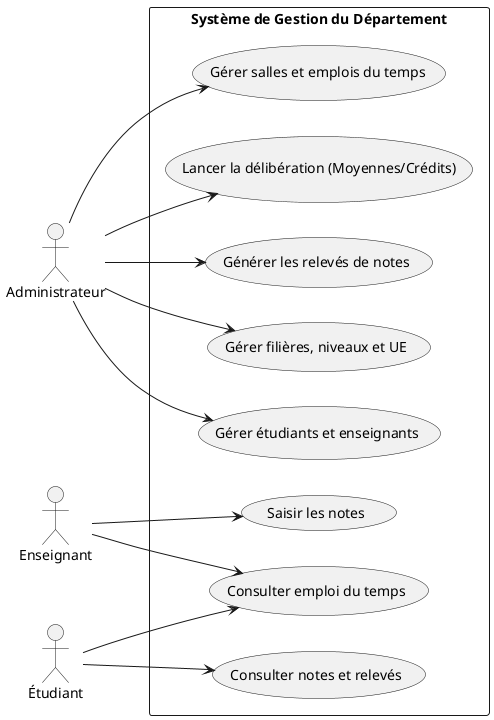
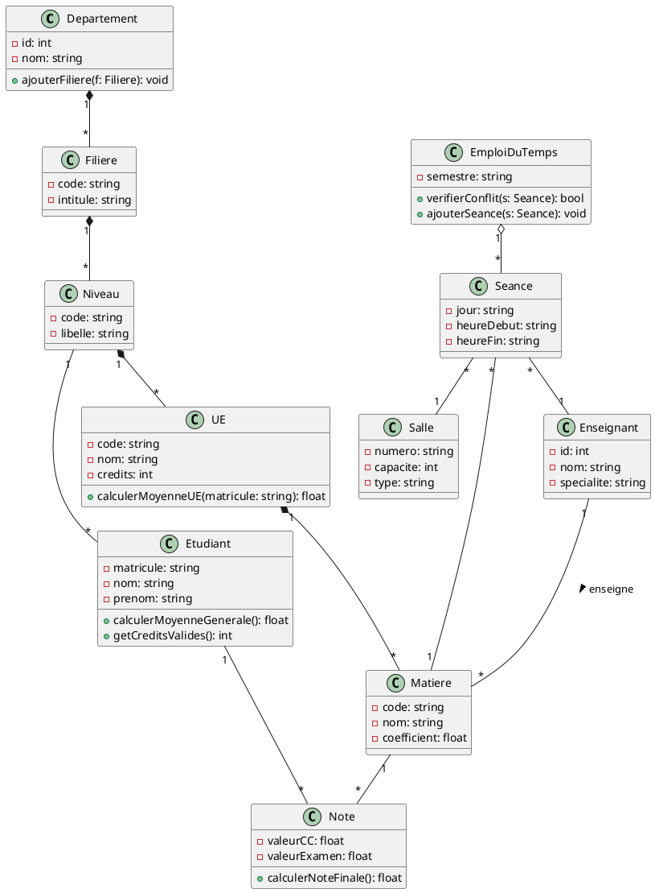
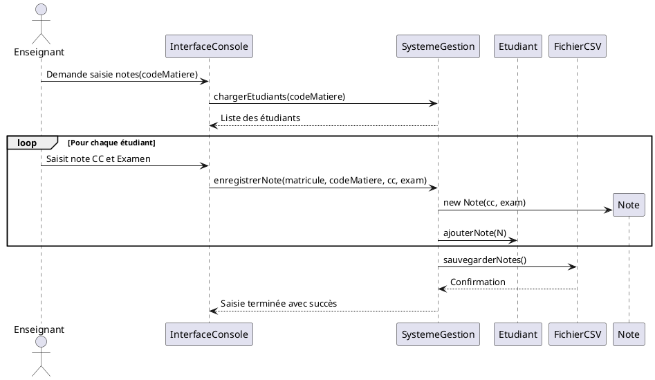
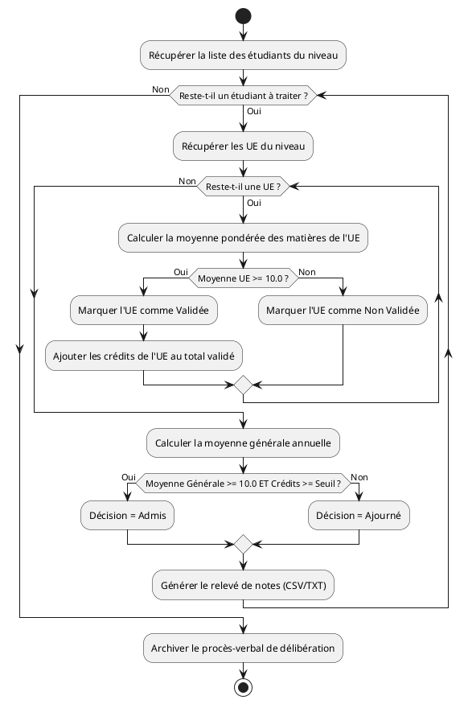
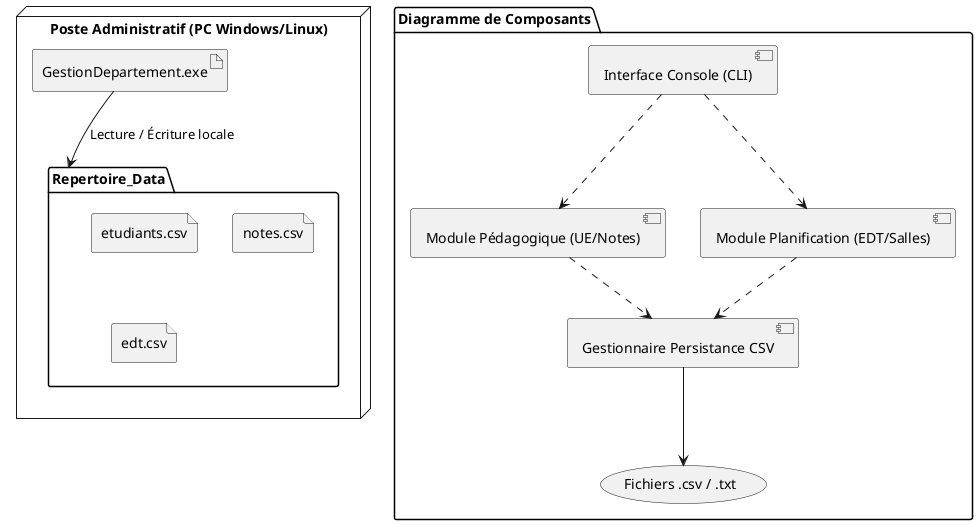

# TP 4 : Système Intégré de Gestion d'un Département Universitaire

## 1. Présentation du Projet
Ce projet consiste à concevoir et développer une application centralisée permettant de gérer les activités administratives et pédagogiques d'un département universitaire :
- Gestion des étudiants et des enseignants.
- Gestion des filières, niveaux, unités d'enseignement (UE) et matières.
- Planification des emplois du temps et gestion des salles (avec détection de conflits).
- Saisie des notes, calcul des moyennes, validation des crédits et génération de relevés de notes.

## 2. Architecture du Projet
```text
GestionDepartement/
├── README.md                 # Documentation complète et modélisation UML
├── docs/
│   └── images/               # Images générées des diagrammes UML (.png)
│       ├── use_case.png
│       ├── class_diagram.png
│       ├── sequence_notes.png
│       ├── activity_deliberation.png
│       └── component_deployment.png
├── include/                  # Fichiers d'en-tête (.h)
│   ├── Models.h
│   └── SystemeGestion.h
├── src/                      # Fichiers sources (.cpp)
│   └── main.cpp
```

## 3. Modélisation UML

> **Note :** Exportez les scripts PlantUML ci-dessous au format PNG dans le dossier `images/` pour afficher les rendus visuels directement dans ce fichier.

### A. Diagramme Global de Cas d'Utilisation


<details>
<summary>Voir le code source PlantUML</summary>


</details>

### B. Diagramme de Classes Complet


<details>
<summary>Voir le code source PlantUML</summary>


</details>

### C. Diagramme de Séquence (Saisie des Notes)


<details>
<summary>Voir le code source PlantUML</summary>


</details>

### D. Diagramme d'Activités (Processus de Délibération)


<details>
<summary>Voir le code source PlantUML</summary>


</details>

### E. Diagrammes de Composants et de Déploiement


<details>
<summary>Voir le code source PlantUML</summary>


</details>

## 4. Compilation et Exécution (C++)

### Prérequis
- Compilateur C++ supportant la norme **C++17** (`g++`, `clang++` ou MSVC).

### Commande de compilation
```bash
g++ -std=c++17 -Iinclude src/main.cpp -o GestionDepartement
```

### Exécution
```bash
./GestionDepartement
```
